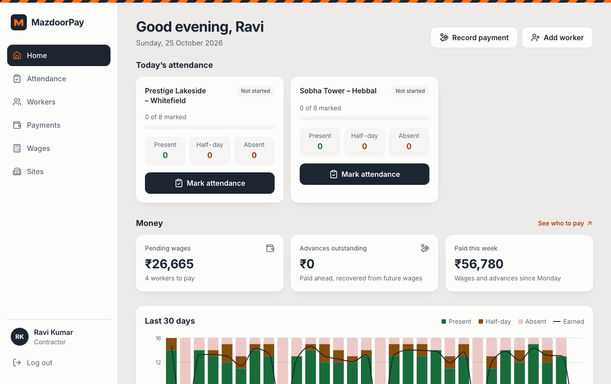
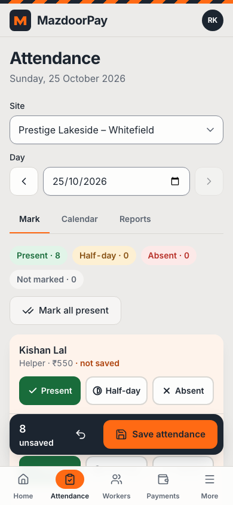
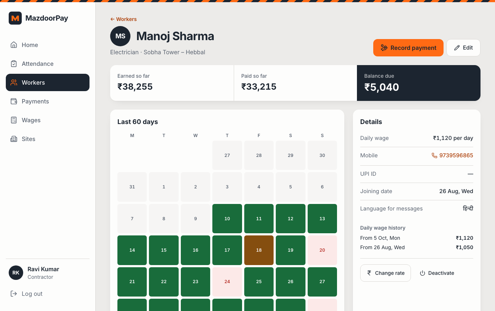
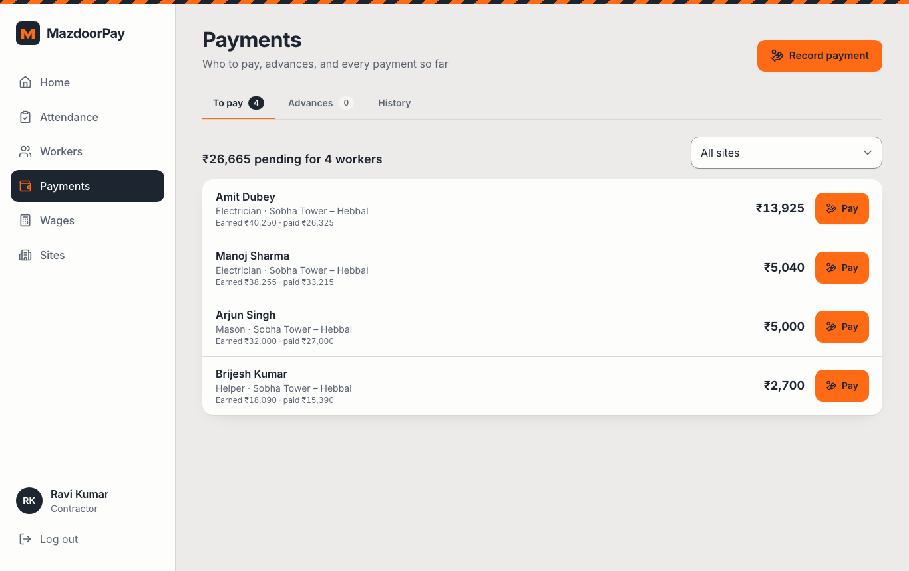

# MazdoorPay

**Attendance, wages and payments for construction sites.** Contractors mark each day's attendance in one tap per worker, MazdoorPay works out every worker's wages, and every payment and advance is recorded — so nobody argues on Saturday.

**Live app → https://mazdoorpay.vercel.app** · [API reference](https://mazdoorpay-api.onrender.com/api/v1/docs/) · [Technical documentation](docs/TECHNICAL.md) · [Product requirements (PRD)](docs/PRD.md)



> The API runs on Render's free plan, which sleeps after 15 minutes without traffic. The first visit after that can take up to a minute; the app shows "Waking up the server…" meanwhile.

## Try it

The login page has a **Use** button for each demo account. The demo data has 30 workers on four sites with 45 days of attendance, weekly payouts in cash and UPI, advances, pay raises and a voided payment.

| Role                                  | Email                        | Password     |
| ------------------------------------- | ---------------------------- | ------------ |
| Contractor — Bengaluru, 2 sites       | `ravi.kumar@mazdoorpay.in`   | `Demo@2026`  |
| Contractor — Pune and Mumbai, 2 sites | `sunita.patil@mazdoorpay.in` | `Demo@2026`  |
| Platform admin                        | `admin@mazdoorpay.in`        | `Admin@2026` |

The demo admin sees only the demo accounts, and demo accounts cannot be suspended or locked out, so the logins keep working for everyone.

## What it does

**For contractors**

- **Statement link** — a private link the worker opens without an account to see their own balance, attendance and payments.
- **Installable** — add it to the phone's home screen and it opens like an app.
- **Dark mode** — follows the phone's setting, with a one-tap switch.
- **Hindi or English** — one tap switches every screen; receipts and wage slips print in each worker's own language.

- **Dashboard** — today's attendance progress per site, wages pending, advances outstanding, money paid this week, and a 30-day trend.
- **Sites** — every site with its worker count.
- **Workers** — search and filter; each worker's profile shows what they earned, what they were paid, and what is still due, with a 60-day attendance calendar and wage history.
- **Attendance** — one tap per worker for present, half-day or absent, or scan workers' printed QR ID cards with the phone camera; "Mark all present", undo and a save bar; month calendar; muster roll and attendance report (CSV and print).
- **Wages** — daily or weekly earnings for any period, with each worker's balance, the wage register (CSV and print), and a printable wage slip for each worker.
- **WhatsApp** — one tap opens WhatsApp with a receipt or this week's summary for the worker, in their language (Hindi or English).
- **Payments** — who to pay, advances still to recover, full history; recording a payment pre-fills what is owed, can open the contractor's UPI app (or show a QR code) with the worker and amount filled in, requires the UTR for UPI, and never records the same payment twice; mistakes are voided, not deleted; a printable receipt for every payment.

**For the platform admin**

- Platform totals, sign-ups per week and activity per day.
- Users: search, read-only view of a contractor's sites and workers (contact details masked), suspend and reactivate.
- Activity log of every change, filterable by contractor, action and date.
- Data checks for records that break the rules, and the project's KPIs with CSV export.

| Mark attendance on a phone                                      | Worker profile                                         | Payments                                   |
| --------------------------------------------------------------- | ------------------------------------------------------ | ------------------------------------------ |
|  |  |  |

## Quality

- **Tests:** 197 API tests (98% line coverage), 185 app tests, and 21 Playwright end-to-end runs covering the full contractor journey, the admin flow, the demo admin's limits, the production Content-Security-Policy, the card scanner, statement links, Hindi, dark mode, the installable app, a 15-worker speed check, phone layouts at 412 and 360 px, and accessibility scans of every page.
- **Accessibility:** Lighthouse 100 on the login page; axe finds no serious or critical issues on any of the 18 pages scanned, also in Hindi and in dark mode; 48 px tap targets; status always shown as colour, icon and word.
- **Performance:** Lighthouse mobile performance 96–98 on the login page; in a local load test of six read endpoints, p99 stayed under 90 ms.
- **Security:** rotating httpOnly refresh cookies with theft detection, login lockout, rate limits a forged proxy header cannot reset, role checks on every request, strict per-contractor data isolation, validation on every endpoint, audit log of every write.
- **CI:** GitHub Actions runs lint, all test suites, the production build, the dependency audit and the end-to-end tests on every push.

Details and numbers: [docs/TECHNICAL.md](docs/TECHNICAL.md).

## Tech stack

| Layer    | Technology                                                                                           |
| -------- | ---------------------------------------------------------------------------------------------------- |
| App      | React 18, Vite, React Router, TanStack Query, Tailwind CSS, Framer Motion, Recharts, react-hook-form |
| API      | Node.js 22, Express 5, Mongoose 8, Zod 4 (schemas shared with the app)                               |
| Database | MongoDB Atlas, with transactions for money                                                           |
| Hosting  | Vercel (app) and Render (API)                                                                        |
| Tests    | Jest, supertest, mongodb-memory-server, Vitest, Testing Library, MSW, Playwright, axe                |

## Repository layout

| Folder    | Contents                                                                                  |
| --------- | ----------------------------------------------------------------------------------------- |
| `shared/` | Validation schemas, constants, India-time date and paise money helpers used by both sides |
| `server/` | Express API under `/api/v1`                                                               |
| `client/` | React app and print views                                                                 |
| `e2e/`    | Playwright end-to-end and accessibility tests                                             |
| `docs/`   | Requirements, PRD, technical documentation, screenshots                                   |

## Run locally

Requires Node.js 22.22.2 or later (or 24.15 or later); the test tools need it.

```bash
npm install
```

The quickest start needs no database: the API runs on an in-memory MongoDB filled with demo data.

```bash
npm run dev:memory -w server   # API on http://localhost:5055
npm run dev:client             # app on http://localhost:5173
```

With a real database, copy `server/.env.example` to `server/.env`, set `MONGODB_URI` (a replica set, such as Atlas, because payments use transactions) and the two secrets, then:

```bash
npm run seed         # replaces only the demo accounts; real users are never touched
npm run dev:server   # API on http://localhost:5055
```

Other commands:

```bash
npm test                          # API and app tests
npm run test:coverage -w server   # API tests with the coverage gate
npm run test:e2e                  # Playwright end-to-end tests
npm run lint                      # ESLint
npm run build                     # production build of the app
npm run backup -w server          # backup of every collection to backups/
npm run create-admin -w server -- --name "Asha Rao" --email asha@example.com --password 'Choose-a-strong-1'
```

## Deployment

- **Database:** MongoDB Atlas. Network access must allow Render (`0.0.0.0/0` on the free tier, whose IPs change), with a database user that can read and write.
- **API:** Render Blueprint from [`render.yaml`](render.yaml) — Node 22, Singapore region, health check `/api/v1/health`. Set `MONGODB_URI` and `FRONTEND_ORIGIN` in the Render dashboard; Render generates the secrets. With `SEED_DEMO_IF_MISSING=true` the API creates the demo accounts on its first start.
- **App:** Vercel project with root directory `client`. [`client/vercel.json`](client/vercel.json) builds the app and rewrites `/api/*` to Render, so the app and API share one address and the login cookie stays first-party.

## Requirements

The original brief is in [docs/REQUIREMENTS.md](docs/REQUIREMENTS.md); the [PRD](docs/PRD.md) maps every requirement to the feature that meets it.
